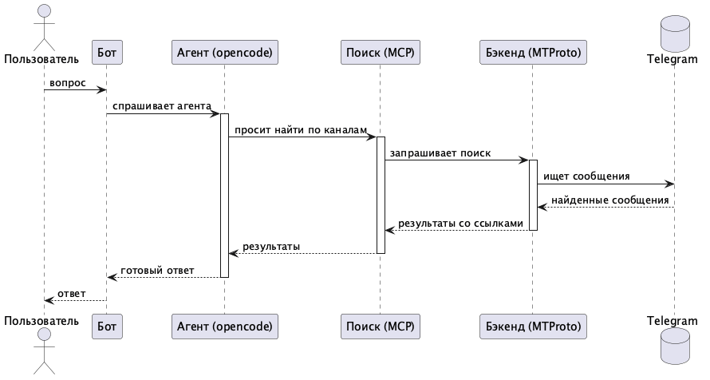

# tg-lurk-ai-bot

Telegram-бот, который отвечает на вопросы, ища информацию в ваших Telegram-каналах,
и присылает краткий ответ со ссылками на источники.

Поиск — по точному подстрочному совпадению (так устроен Telegram), поэтому бот
выделяет из вопроса ключевые запросы, ищет их в сохранённых каналах и сводит
результат в лаконичный ответ силами DeepSeek через headless-сервер OpenCode
(агент + скиллы + MCP-инструмент поиска).

## Архитектура



> Исходник диаграммы — `docs/architecture.puml` (PlantUML).

Процессы:

| Бинарь | Роль |
|---|---|
| `bot` | Telegram-фронтенд: команды, QR-вход, распознавание голоса, вызов OpenCode, отправка ответа |
| `backend` | MTProto-бэкенд: per-user сессии (зашифрованы AES-256-GCM), вход и поиск |
| `mcp` | MCP-сервер (stdio), который OpenCode запускает как `tg-search` и который проксирует `search_tg` в backend |
| `stt` | локальный speech-to-text (Vosk): принимает PCM и отдаёт распознанный текст |

Работать можно двумя способами:

- **Без входа** (по умолчанию) — поиск только по публичным каналам. Поиск идёт
  через единый служебный MTProto-аккаунт («shared»-сессия), который настраивает
  администратор командой `/qrlogin_shared`.
- **Со своим аккаунтом** (`/qrlogin`) — дополнительно ищет в приватных каналах,
  к которым у пользователя есть доступ.

Сессии хранятся зашифрованными на диске.

## Схема БД

SQLite, таблица `channels` (по пользователю):

| Колонка | Тип | Описание |
|---|---|---|
| `user_id` | INTEGER | Telegram user id |
| `channel` | TEXT | имя канала (`@channel`) |
| `added_at` | INTEGER | unix-время добавления |
| `title` | TEXT | название канала |
| `about` | TEXT | описание канала |

Первичный ключ — `(user_id, channel)`.

MTProto-сессии в SQLite не хранятся: это отдельные файлы
`data/sessions/<user_id>.session` (для общего аккаунта — `data/sessions/shared.session`),
зашифрованные AES-256-GCM (`SESSION_KEY`).

## Команды бота

- `/qrlogin` — вход своим аккаунтом через QR-код (сканируете и подтверждаете на телефоне, при 2FA — вводите пароль). Нужен только для приватных каналов.
- `/qrlogin_shared` — вход общего служебного аккаунта (только для администраторов из `ADMIN_USERS`); нужен один раз для поиска по публичным каналам без входа.
- `/add_channels` — добавить каналы (бот попросит прислать имена одним сообщением).
- `/remove_channels` — убрать каналы (бот покажет список и попросит прислать имена).
- `/list_channels` — показать сохранённые каналы.
- `/cancel` — отменить незавершённый вход.
- обычное сообщение — вопрос, на который бот ищет ответ.
- голосовое сообщение — то же, что текстовый вопрос (распознаётся Vosk, если включено `STT_ENABLED=true`).

## Требования

- Go 1.26+
- OpenCode + DeepSeek API-ключ (модель задаётся в `OPENCODE_MODEL`)
- Telegram Bot API токен (`@BotFather`)
- MTProto `api_id`/`api_hash` с https://my.telegram.org/apps

## Сборка

```bash
go build ./...
# бинарники в ./bin (или любую целевую папку)
go build -o bin/bot ./cmd/bot
go build -o bin/backend ./cmd/backend
go build -o bin/mcp ./cmd/mcp
```

### Низкая память на VDS (2 ГБ)

Компиляция `github.com/gotd/td/tg` требует больше 2 ГБ RAM, поэтому на VDS с 2 ГБ
собирайте бинарники на другой машине и заливайте готовыми.

На своей машине (Mac/Linux с достаточной памятью):

```bash
./cross-compile.sh          # кладёт bot/backend/mcp в dist/ (linux/amd64)
```

На сервер нужно заливать **только эти три бинарника**. Весь остальной код —
`.opencode/`, `opencode.json`, `deploy/*.service`, `.env.example` — `deploy.sh`
сам подтянет через `git clone`:

```bash
scp dist/bot dist/backend dist/mcp user@IP:/tmp/
ssh user@IP
sudo mkdir -p /opt/tg-lurk-ai-bot/bin
sudo cp /tmp/bot /tmp/backend /tmp/mcp /opt/tg-lurk-ai-bot/bin/
sudo SKIP_BUILD=1 bash deploy.sh
```

Либо добавьте swap на VDS и собирайте на месте обычным `sudo bash deploy.sh`.

## Настройка

Скопируйте `.env.example` в env-файл (см. `deploy/*.service`, по умолчанию
`/etc/tg-lurk-ai-bot/env`) и заполните значения. Ключ шифрования сессий:

```bash
openssl rand -hex 32
```

OpenCode должен видеть `opencode.json` и `.opencode/` из рабочей директории
`opencode serve` — в юнитах это `/opt/tg-lurk-ai-bot`. Путь до MCP-бинаря в
`opencode.json` (`/opt/tg-lurk-ai-bot/bin/mcp`) поправьте под свой деплой.

`opencode serve` требует пароль: `OPENCODE_SERVER_PASSWORD` (в `EnvironmentFile`),
а DeepSeek-ключ передаётся стандартно (`/connect` или `DEEPSEEK_API_KEY`).

### Белый список пользователей

По умолчанию ботом может пользоваться любой. Чтобы ограничить доступ, задайте
переменную `ALLOWED_USERS` — список Telegram-логинов (без `@`) через запятую:

```
ALLOWED_USERS=alice,bob,carol
```

Если переменная задана, бот игнорирует сообщения от всех, кроме перечисленных
пользователей (сверка по `@username`).

Отдельно есть `ADMIN_USERS` — те же логины, которым разрешена команда
`/qrlogin_shared` (вход общего служебного аккаунта). Если переменная не задана,
админ-команды выключены.

## Деплой (systemd)

Проще всего — через `deploy.sh`: он ставит Git/Go/OpenCode, клонирует репозиторий,
собирает бинарники, создаёт env-файл и поднимает все три сервиса.

```bash
sudo bash deploy.sh
```

Первый запуск останавливается после создания env-файла — заполните его
(`/etc/tg-lurk-ai-bot/env`) и запустите скрипт ещё раз.

Переменные `deploy.sh`:

- `SKIP_BUILD=1` — не собирать бинарники, использовать уже лежащие в
  `/opt/tg-lurk-ai-bot/bin/`. Нужен на VDS с 2 ГБ, где сборка gotd падает по
  памяти (см. «Низкая память»).
- `GO_VERSION=1.26.2` — версия Go для установки.

`deploy.sh` по итогу делает то же, что вручную:

```bash
sudo cp deploy/*.service /etc/systemd/system/
sudo systemctl daemon-reload
sudo systemctl enable --now backend.service opencode-serve.service bot.service
```

Все порты слушают только `127.0.0.1` — наружу ничего не открывается.

Сервисы работают от системного пользователя `lurk_ai_bot` в группе `users`;
каталог бота — `/opt/tg-lurk-ai-bot`, env-файл — `/etc/tg-lurk-ai-bot/env`.

## CI/CD (GitHub Actions)

`.github/workflows/deploy.yml` на каждый push в `main`:
собирает бинарники на ubuntu-латере (`GOOS=linux GOARCH=amd64`), копирует их вместе с
`.opencode/` и `opencode.json` на сервер под пользователем `deploy`, затем выполняет
`sudo /usr/local/bin/deploy-tg` (установка + перезапуск сервисов).

Секреты репозитория: `DEPLOY_SSH_KEY` (приватный ключ), `DEPLOY_HOST`, `DEPLOY_USER`.

## Как устроена обработка (OpenCode)

- Агент `answer` (`.opencode/agent/answer.md`) — роль и правила.
- Скиллы: `extract-keywords` (выделение поисковых запросов), `select-channels`
  (выбор релевантных каналов по описаниям) и `answer-format` (оформление ответа).
- Инструмент `search_tg` — MCP-сервер `tg-search`, объявленный в `opencode.json`.

Бот на каждый вопрос создаёт сессию и шлёт промпт с `user_id` и списком каналов
(с описаниями). Агент выделяет ключевые слова, выбирает 1–4 релевантных канала
и вызывает `search_tg` только по ним, затем сводит результат в ответ со ссылками.

## Голосовые вопросы

Голосовые сообщения распознаются локально (Vosk) и идут в тот же пайплайн, что и текст:

```
voice → скачать OGG → ffmpeg (PCM 16 кГц) → [stt: Vosk] → текст → обычный пайплайн
```

Для включения нужно:

- `STT_ENABLED=true` (+ `STT_ADDR`, `STT_MODEL_DIR`) в env;
- модель `vosk-model-small-ru-0.22` в `/opt/tg-lurk-ai-bot/models/vosk`;
- `ffmpeg` и `libvosk.so` (в `/usr/local/lib/`);
- сервис `stt.service` (бинарь `stt` собирается отдельно с `-tags vosk` и cgo, ставится CI/CD).

## Ограничения

- Telegram ищет по точному подстрочному совпадению, не по смыслу. Качество зависит
  от того, как агент выделит ключевые слова.
- Поиск работает только в каналах, доступных аккаунту пользователя; без входа — только в публичных каналах.

## Вход

Вход нужен только для поиска по приватным каналам. Для публичных каналов он не
обязателен: поиск идёт через общий служебный аккаунт, который администратор
логинит один раз командой `/qrlogin_shared` (доступно пользователям из `ADMIN_USERS`).

Для входа своим аккаунтом — QR-код (`/qrlogin`): бот присылает картинку, вы сканируете
её на телефоне (Telegram → Настройки → Устройства → Подключить устройство), подтверждаете,
при включённой 2FA вводите пароль.

Ссылка для входа намеренно не присылается — только QR-код: ссылка несёт тот же
одноразовый токен, и повторные тапы по ней ломают попытку входа.

С IP дата-центра Telegram блокирует вход по коду (`PHONE_CODE_EXPIRED`) и быстро гасит
QR-токены, поэтому QR-вход — основной путь для обычных пользователей. Сообщение с паролем
2FA бот удаляет сразу после обработки, чтобы оно не оставалось в истории чата.

## Безопасность

- MTProto-сессии шифруются AES-256-GCM (`SESSION_KEY`) и хранятся с правами `0600`.
- `SESSION_KEY`, токены и пароли не коммитятся (см. `.gitignore`).
- Не открывайте порты бэкенда и opencode наружу; всё — на loopback.
